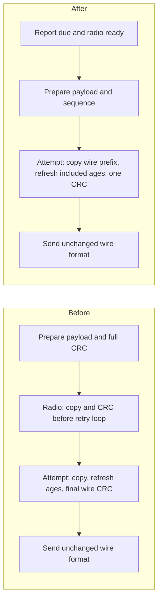

# Main, radio and OTA flow optimization - 2026-11-07

Publication follow-up: these measurements preserve the pre-release 4.4.3 local
reference. The changes are now packaged as [4.4.4 / 40404](releases/README.md);
release-build hashes and checks are separate from the historical audit artifacts.

## Scope and immutable reference

This third pass extends the [MCU optimization review](MCU_OPTIMIZATION_REVIEW.md)
with seven changes to packet preparation, radio copies/queues, acquisition,
OTA resume, station transfer reads and telemetry registration. The before
column is the preserved **previous local result**, including the earlier
uncommitted fixes. It is not clean HEAD. HEAD remains
`ff7afa30032221ec961f2bc939c1dbba4c90a0c2`.

The full maintained before tree is retained in ignored
`.tools/firmware-flow-20261107/before-worktree.zip`; the
[manifest](audit/2026-11-07-flow/artifact-manifest.json) identifies it and all
before/after ELF, BIN, map and partition files. Earlier artifacts are retained.
Build/tool settings and preservation rules from the local `wcharger-release`
skill are unchanged: GCC 14.2.0, matching RISC-V/Xtensa binutils 2.43.1,
`-Os`, no LTO, effective C++20, public path mapping, C3 80 MHz and S3 240 MHz.

The source inventory grows from 214 modules / 1,872 definitions to 222 / 1,912,
including tests. Production/build scope remains 101 modules, now 1,129
definitions. There are no AST parse errors. All changed production blocks were
source-reviewed; unchanged modules retain the earlier audit's review scope.
All emitted own entries were structurally surveyed: V3 161 -> 162, V4 165 ->
165, S3 289 -> 291. Detailed assembly checks follow the changed calls, copies,
branches, fences and frames. Inlining/clones and indirect Xtensa calls still
prevent a one-to-one source/execution-coverage claim.

## Main and send sequence

`makeTelemetryPacket()` prepares payload and sequence, leaving wire-header/CRC
ownership to the transport. `setup()` constructs telemetry only after a report
is due and the radio starts successfully. Live captures can enter the journal
without computing an unused packet-header CRC; outgoing ages/configuration are
still refreshed before each actual send. Status/upload recording packets keep
their independent finalization and durable ACK rules.

For environmental telemetry succeeding on its first attempt, the executed
stage counters compose as 207 + 60 + 60 = 327 CRC input bytes before, versus
60 after (-267 / -81.65%). This excludes station response construction and
validation. It is a work-count comparison, not an airtime or elapsed-time claim.

| Scenario / measurement | Before | After | Evidence / scope |
| --- | ---: | ---: | --- |
| Main payload preparation | 1 CRC / 207 bytes | 0 / 0 | Actual main function with real protocol implementation and counting wrapper |
| BME680 maintenance-only wake | 1 unused telemetry CRC | 0 | Production boot flow; sensor work and 300-second maintenance sleep retained, radio off |
| Transport, one-attempt environmental send | 2 CRCs / 120 bytes | 1 / 60 | Real transport; input/station-reply CRCs excluded from this counter |
| Per-attempt environmental packet copy | 207 bytes | 60 bytes | Actual emitted copy argument and unchanged transmitted prefix; -147 / -71.01% |
| Wire bytes | Short/motion/full V5 formats | Identical | Both attempts compared byte for byte against the original algorithm |

The plain internal wire buffer copies exactly the selected prefix; static
assertions establish header/payload layout. Age patches occur only when that
metadata is transmitted. Unknown-age sentinels, saturation at 65534, unused
optical slots, sequence correlation, backoff, channel coverage and send
completion limits remain intact. The caller's packet remains immutable.

## Radio memory and callback publication

The four-item OTA response queue is created before the first OTA pull request,
rather than on every radio start. Base telemetry can still operate if that
optional allocation fails. OTA responses cannot race queue initialization:
the main task publishes fully initialized queue handles with release stores;
Wi-Fi callbacks load them with acquire ordering. The existing lazy recording
queue now uses the same publication rule. Shutdown still unregisters callbacks
and stops ESP-NOW before freeing queues; real SDK callback quiescence remains
a device/runtime boundary.

| At radio begin | Before | After | Limit |
| --- | ---: | ---: | --- |
| Queue creations | 2 | 1 | Measured actual `xQueueCreate` calls |
| Queue data storage | 1,124 bytes | 220 bytes | -904 bytes; excludes RTOS control-block/allocator overhead |
| Active OTA capacity | Four responses | Four responses | Same maximum capacity once needed |

The saving applies while OTA is unused, including discovery, offline and
battery-protection exchanges. A normal report that proceeds to OTA allocates
the queue later, reaching the previous data-storage total. Allocation-failure,
subsequent retry, reuse, wrong sender/nonce/sequence and missing-callback tests
pass. Atomics add ordering work; this is also a correctness requirement, not
a claimed callback-speed improvement.

## Acquisition: consume the checked snapshot once

The acquisition owner already calls `pollLive()` before deciding to publish a
capture. It now calls `read(false)` to consume that checked snapshot. Ordinary
driver callers keep the default `read(true)`. This preserves the original
poll/decision order and report anchor while avoiding a second status/FIFO read.
Validity, sample-age, gap, count and window checks still execute; a stale
snapshot cannot become a valid reading merely by skipping another poll.

| IMU fixture / measurement | Before | After | Evidence |
| --- | ---: | ---: | --- |
| Same acquisition run, 19 captures | 230 driver polls | 211 | Actual acquisition loop with driver-boundary model; -19 (-8.26%) |
| Duplicate same-tick polls | 19 | 0 | Same fixture, same capture count |
| Additional I2C read after an explicit poll | 1 | 0 | Real LSM6DSOX driver with I2C substitute; same values; stale snapshot rejected |

These are host/API counts. Poll overlap with real asynchronous FIFO arrival,
normal-window rail shutdown and concurrent flash/RF activity still require
hardware acceptance. No polling interval or acquisition mode was changed.

## OTA: reuse the sensor buffer and cache station reads

Sensor resume verification uses the existing 4096-byte sector buffer instead
of a separate 1024-byte stack buffer. It still hashes every committed prefix
byte and compares the saved prefix digest before resuming. Failed reads or a
corrupt prefix restart the transfer; buffer-allocation failure is reported
without beginning or selecting an image. Durable checkpoints remain 16384
bytes and only flushed data enters the hash/checkpoint.

The station reads ahead up to eight 192-byte blocks into a lazy 1536-byte
buffer. Sequential requests and retries reuse it. The cache is cleared for
job replacement, cancellation, restart and applicable status transitions.
Target/nonce checks, signature validation, full uploaded-image hash and durable
job/cancel operations are retained. Allocation failure or speculative-read
failure falls back to the original direct requested-block read. Failed cache
bytes are never marked valid. Arbitrary valid offsets and final short blocks
remain supported.

| OTA scenario / measurement | Before | After | Change / domain |
| --- | ---: | ---: | --- |
| Verify 16,384-byte resume prefix | 16 reads / 16,384 bytes | 4 / 16,384 | -75% read calls; all bytes checked |
| Sensor OTA local frame, V3/V4 | 2,304 bytes | 1,280 bytes | -1,024 (-44.44%); GCC and actual split prologue |
| 70,000-byte station transfer | 365 packets / 365 flash reads | 365 / 46 | -319 (-87.40%) read calls; same 70,000 flash bytes |
| Maximum 1,310,720-byte slot | 6,827 packets / 6,827 flash reads | 6,827 / 854 | -5,973 (-87.49%) read calls; same image bytes |
| Sensor full-slot writes | 320 sectors | 320 sectors | Unchanged existing write buffering and durability |
| Sensor heap sector buffer | One x 4096 bytes | One x 4096 bytes | Reused, no additional buffer |
| Station read cache | None | Up to 1536 active heap bytes | One lazy allocation, direct-read fallback |

The full-slot fixtures compare every returned block/CRC and the complete
sensor-written image. They test tail/retry/resume, old-job invalidation,
wrong nonce, invalid offsets, busy lock, read/allocation failures, durable
cancel and rejected signature/digest results. Their hash/signature substitutes
verify control flow and byte ordering; six independent package tests use real
SHA-256/ECDSA. JSON is outside the station transfer fixture; real serializer,
browser and target checks remain separate.

Fewer flash API calls do not prove an eightfold transfer-speed improvement.
The 192-byte protocol, packet count and airtime are unchanged. Prefetch increases
the first-miss read size and adds a memory copy per reply. Measure complete
update duration, first-reply tails, internal-heap reserves and normal telemetry
latency on real hardware before making throughput/energy claims.

## Station telemetry registration

The registry saves the two previous IAQ scalars, copies incoming telemetry
directly to runtime state and restores stale IAQ display data when required.
It no longer copies the full 191-byte packed payload through a stack temporary.
Input validation, generation/duplicate handling, mutex scope, raw-fallback
flags, source immutability and persistence inputs remain unchanged.

| Native S3 metric | Before | After | Change |
| --- | ---: | ---: | ---: |
| Registration function | 1,532 bytes | 1,496 bytes | -36 |
| Static instructions | 572 | 565 | -7 |
| Local frame | 464 bytes | 288 bytes | -176 (-37.93%) |

The optional host benchmark uses nine runs of 20,000 registrations per
type/version. It exercises normal BME280 packets and alternating BME680 raw
fallback, preserving final IAQ and packet counts. Experiment A ran before then
after; B reversed that order. Windows x86_64, Clang 20.1.2 / Zig 0.15.2,
C++17 `-O2 -UNDEBUG` and fixture locks are identical within each comparison.

| Experiment B, host batch average | Before median (range), us/packet | After median (range), us/packet | Median change |
| --- | ---: | ---: | ---: |
| BME280 registration | 0.015695 (0.015600-0.015740) | 0.013920 (0.013875-0.014135) | -11.31% |
| BME680/raw fallback | 0.015630 (0.015620-0.015800) | 0.013785 (0.013770-0.013955) | -11.80% |

Experiment A medians were 0.017610 -> 0.013560 and 0.017565 -> 0.013570
us/packet; full ranges are retained in the measurements. The variation between
experiments limits any universal host speed percentage. These are batch
averages, not single-packet radio latency or ESP32 timings. Native copy/frame
reductions support an on-device benefit indirectly.

## Machine code and combined costs

[Function comparisons](audit/2026-11-07-flow/function-comparison.csv) include
all selected V3, V4 and S3 bodies. Representative V4 costs illustrate that
less total work need not mean every function becomes smaller:

[Actual assembly excerpts](audit/2026-11-07-flow/assembly-excerpts.md) show the
removed copy/CRC sites and changed RISC-V/Xtensa frame instructions.

| C3 path | Code before/after | Local frame before/after |
| --- | ---: | ---: |
| `setup()` | 4,480 / 4,412 bytes | 1,600 / 1,600 bytes |
| Payload builder | 696 / 714 | 48 / 48 |
| `tryChannel()` | 952 / 890 | 304 / 336 |
| Radio `begin()` | 208 / 154 | 16 / 16 |
| `otaExchange()` | 448 / 510 | 288 / 304 |
| `recordingExchange()` | 400 / 420 | 96 / 112 |
| `LiveAcquisition::loop()` | 1,158 / 1,160 | 512 / 512 |
| `checkOta()` | 1,934 / 1,824 | 2,304 / 1,280 |

The selected native prologues agree with the auxiliary GCC frames. Split C3
stack adjustments and hexadecimal Xtensa entries were checked explicitly.
Complete disassemblies remain local. Static instruction/call counts are not
execution traces, instruction-cache behavior or a WCET proof.

| Target | Follow-up before Flash | After Flash | Change | Static RAM before/after |
| --- | ---: | ---: | ---: | ---: |
| V3 | 1,076,617 bytes | 1,076,505 bytes | -112 | 45,908 / 45,908 bytes |
| V4 | 1,077,545 bytes | 1,077,393 bytes | -152 | 45,908 / 45,908 bytes |
| S3 | 1,590,566 bytes | 1,590,906 bytes | +340 | 108,268 / 108,284 bytes |

Flash is PlatformIO's used-program metric. Static RAM excludes runtime heap
and task high-water marks. IRAM sections and partition binaries remain unchanged.
The station cache adds up to 1536 heap bytes plus allocator overhead while
active. Queue control-block overhead is not included in the 904-byte saving.
No new task, persistent format, release identity or installation key was added.

The station's `setup()` and `loop()` were reviewed and compared: `setup()`
remains 687 code bytes / 1072 local bytes, and `loop()` remains 70 bytes / 24
instructions with the same Wi-Fi, persistence, portal and yield order. An
unmeasured change to those service deadlines was not used to claim a speed gain.
Synchronous cloud/account responses and initial Wi-Fi/AP work remain integration
and latency concerns from the previous audits.

## Validation and remaining acceptance

All three final targets build. All 30 host suites pass normally and with
undefined-behavior/alignment/float-cast checks; additional wire/offset cases
also pass independently. Six modified comparison suites run against the archived
production reference, and maximum-slot tests pass in both versions. Three
relevant browser programs (OTA status, recording dashboard, interaction stress)
pass again; the first two audits retain the full ten-program results. Six real
crypto package tests and four upload-preservation tests pass. Syntax, whitespace,
source/artifact hash consistency and final publication results are recorded in
the [evidence](audit/2026-11-07-flow/README.md).

All three library patch checks pass against pinned pristine upstream inputs,
including repeat application and incompatible-input rejection. Seven publication
scanner regressions and all eight embedded-script syntax checks pass as well.

Initial fixture builds needed updated driver signatures, the Arduino dependency
in the new station fixture and a corrected benchmark cast. They were fixed
before recording successful comparisons. Prologue tooling was corrected for
split adjustments/early return paths and checked against GCC before reporting
frame values. No failed or pending production check is treated as passed.

Physical acceptance remains prioritized as follows:

1. Verify old/new node/station interoperability, all telemetry prefixes,
   retries and OTA resume under RF loss; measure complete updates and reply
   tails against normal telemetry deadlines, including cache misses/fallbacks.
2. Measure task stack watermarks and internal/PSRAM reserves at 19 nodes with
   HTTP/TLS/OTA/storage pressure; confirm the lazy queues/cache release memory
   across repeated success, pause, cancel and restart cycles.
3. Exercise real FIFO arrival during the poll/snapshot boundary, rail shutdown,
   low/invalid V4 supply, power cuts at checkpoints and trial-boot rollback;
   compare reference measurements, charge per cycle and long-uptime behavior.

No device was accessed, flashed, erased, reset or physically measured. No
package was released, and no commit, push or merge was performed. All changes
remain local on release identity 4.4.3 / 40403.

## Changed-file scope

Paths are relative to `Firmware/`; earlier local changes remain preserved.

- Sensor control/transport: `sensor/src/main.cpp`,
  `sensor/include/espnow_transport.h`, `sensor/src/espnow_transport.cpp`.
- Snapshot API: `sensor/include/environmental_sensor.h`,
  `sensor/src/environmental_sensor.cpp`, `sensor/include/lsm6dsox_driver.h`,
  `sensor/src/lsm6dsox_driver.cpp`, `sensor/include/precision_sensors.h`,
  `sensor/src/precision_sensors.cpp`, `sensor/src/live_acquisition.cpp`.
- OTA/registry: `sensor/src/ota_client.cpp`, `station/include/ota_service.h`,
  `station/src/ota_service.cpp`, `station/src/sensor_registry.cpp`.
- Tests: counter/real-protocol wrapper, boot/transport/acquisition/IMU/registry/
  OTA fixtures and runner; `after-modules.csv` and `module-review.csv` identify
  every changed/new source module, including all station OTA substitutes.
- Documentation: this report, the two earlier audit links, changelog, test
  guide, hardware acceptance additions and `audit/2026-11-07-flow/` artifacts.
