<div align="center">

# W-Charger

### A second life for a recovered battery. A complete wireless sensor network.

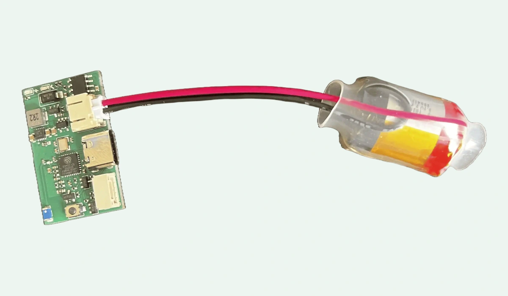

[](LICENSE)


[](Firmware/releases/README.md)

**[Dashboard](#one-dashboard-for-the-whole-network)** · **[Hardware](#choose-your-sensor)** · **[Get started](#from-clone-to-first-measurement)** · **[Downloads](Firmware/releases/README.md)**

</div>

W-Charger turns suitable recovered rechargeable cells into power sources for
compact ESP32-C3 sensor nodes. One ESP32-S3 station collects their measurements
over ESP-NOW and serves a local website for setup, history, recordings and
signed sensor updates. Optional ThingSpeak export adds cloud access.

<p align="center">
  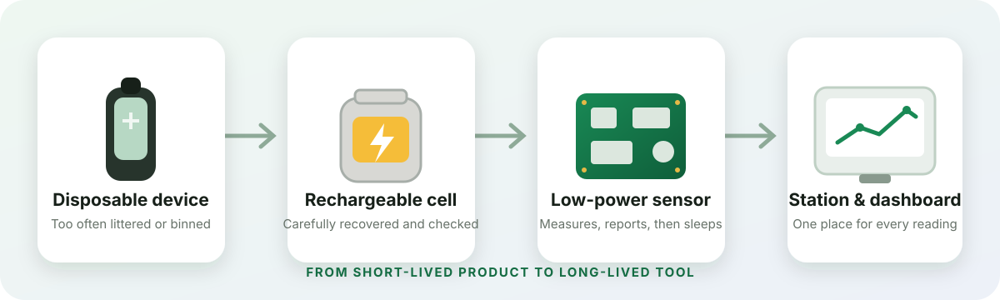
</p>

## One dashboard for the whole network

<p align="center">
  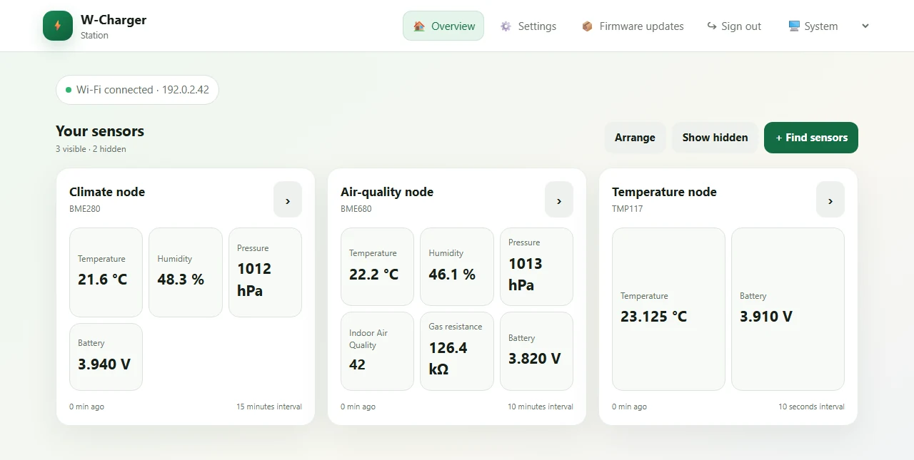
</p>

**Click a card to open its details, or a measurement tile to open its chart.**
The interface adapts to each sensor and works on desktop and phone, with light,
dark and system themes. Collection continues when the browser is closed.

| What you want to do | Where to find it |
| --- | --- |
| Add a node | **Find sensors** discovers nearby nodes. Name the device, choose its sensor and set its interval; no station address or Wi-Fi credentials are hard-coded into sensor firmware. |
| Keep the overview tidy | **Arrange** saves order, visibility, columns and spacing on the station and exposes the dashboard refresh rate. Hidden nodes continue measuring; **Show hidden** brings them into view. |
| Check measurements | Cards show current values, battery voltage and last contact. Details add radio strength, firmware, operating mode, pending settings and sensor/storage faults. |
| Explore history | Choose a measurement and period, browse previous windows or return to **Now**. Hover, tap or use arrow keys for exact values; touch selections stay pinned. |
| Export data | **Display options & export** provides display filters and full retained-history CSV. Filters and the selected chart window preserve original cursor and export values. |
| Adjust a sensor | **Device information & settings → Edit** changes type, name, interval and cloud fields. Calibration includes battery voltage, BME680 temperature compensation/IAQ reset and a separate motion zero reference. |
| Connect ThingSpeak | **Settings** manages optional channel profiles and account channels; each measurement can use a field from 1–8 or **Do not upload**. |
| Maintain the fleet | **Firmware updates** lists installed versions, checks package/board compatibility and tracks queued, transferring, verifying, restarting and confirmed updates. |

<details>
<summary><strong>Open the history and settings views</strong></summary>

<p align="center">
  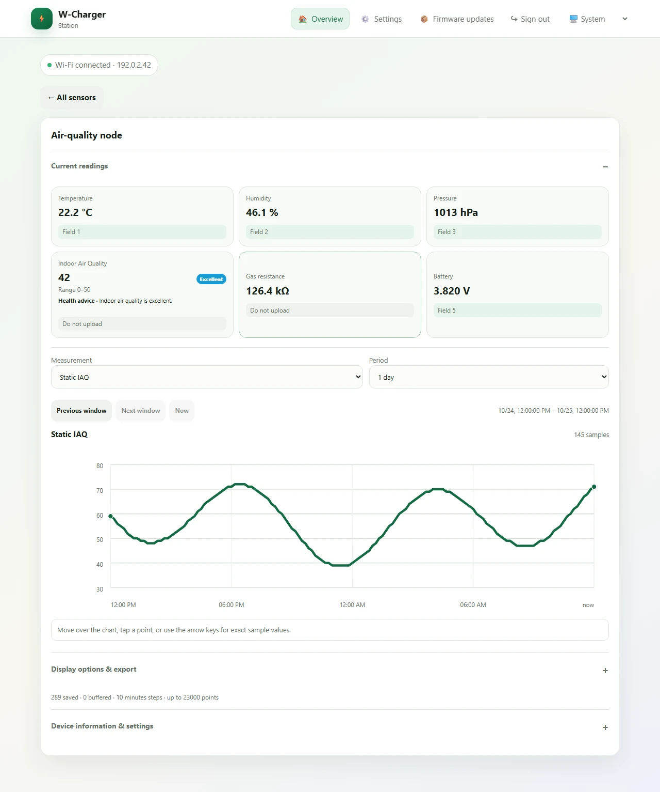
</p>

Normal history is saved on the station. Retention adapts to reporting intervals,
sensor count and shared storage; the detail view reports saved/buffered points
and capacity. Choose **All retained data** to inspect the full available range.
Short intervals are batched, so sudden power loss can lose the latest
uncommitted samples. Storage is finite and shared with saved recordings.

<p align="center">
  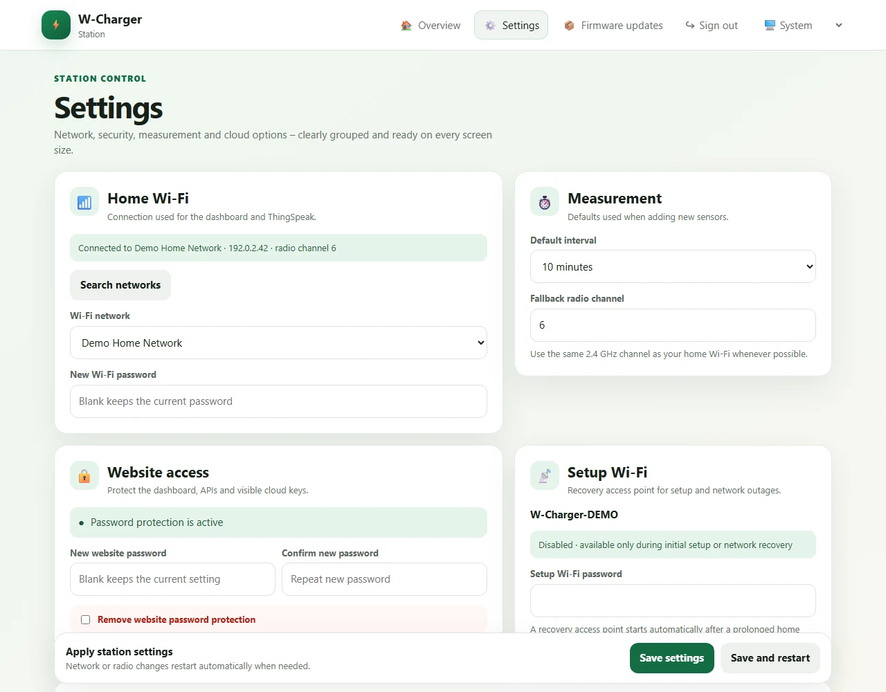
</p>

**Settings** groups network, default interval, website password and cloud
configuration. Sensor intervals can range from one second to 24 hours;
BME680 keeps its separate five-minute background learning cycle.
ThingSpeak channels can be loaded, created, edited, cleared or deleted.
Passwords and API keys are entered through the browser and saved on the station.

</details>

### Record a measurement session

For **LSM6DSOX, TMP117 and MAX30102**, press **SW2 on the sensor** to start a
separate fast recording, then press it again to stop. The session synchronizes
after stopping and remains available on the station independently of the node.
Starting another session replaces any previous unsynchronized sensor copy.

In the sensor details, **Recording selection** switches between the live view
and saved sessions. Open the whole recording or minute details, inspect exact
samples, export the **complete selected recording** as CSV, or delete it to free
space. Completed graphs stay stable while the dashboard refreshes.

<details>
<summary><strong>Open a saved motion recording in dark mode</strong></summary>

<p align="center">
  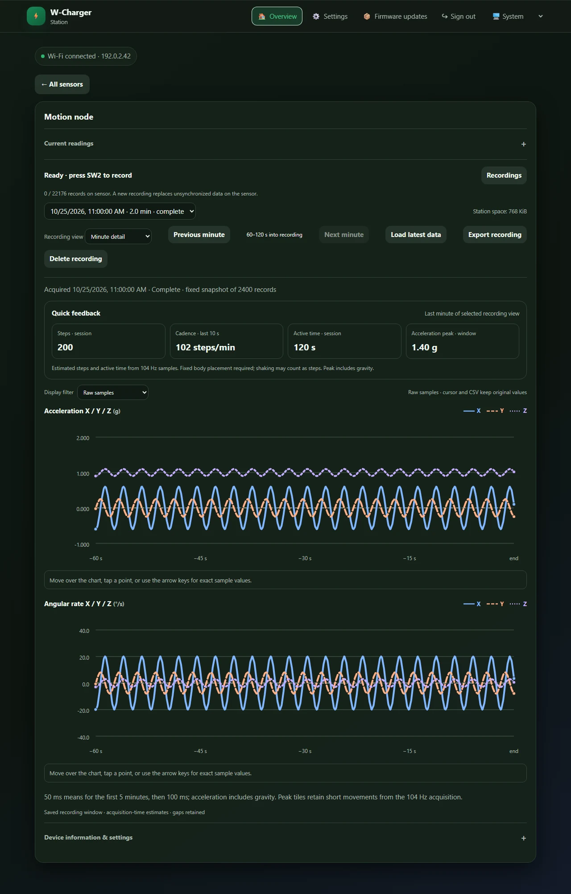
</p>

Normal TMP117/LSM6DSOX measurements follow the configured interval with the rail
off between windows. SW2 starts their independent faster recording mode;
MAX30102 acquisition is SW2-only. Browser controls browse and export sessions;
acquisition follows the physical button. See [rates and storage limits](Firmware/RECORDINGS.md).

</details>

### Update sleeping nodes from the station

<p align="center">
  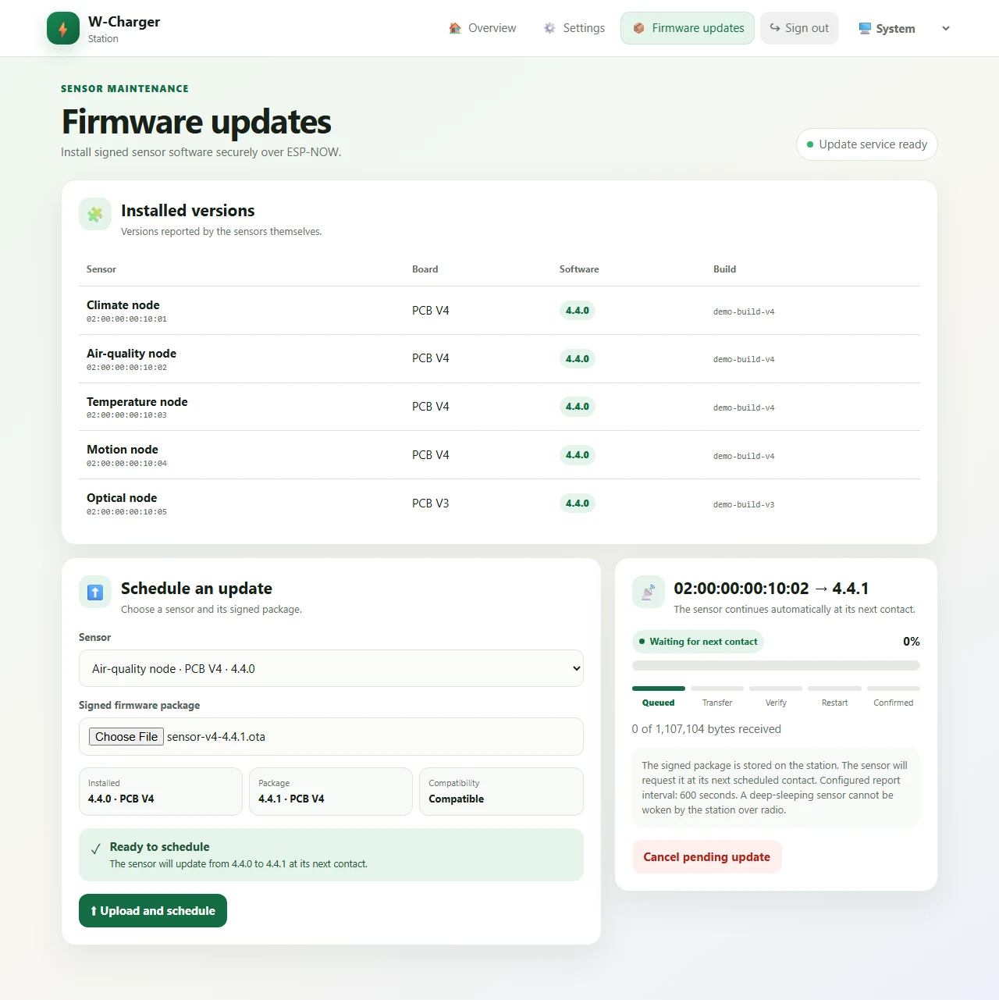
</p>

Choose a sensor and its signed `.ota` package, then **Upload and schedule**.
After the station confirms scheduling, it stores the package and serves it at
the node's next contact. Transfers resume after interruptions; successful trial
boots are confirmed, and a failed trial can restore the previous image. A
sleeping sensor waits for its scheduled contact, and battery protection can
postpone updates. The station itself is updated over USB.

## Choose your sensor

One four-pin I²C connector and one sensor codebase support both PCB revisions.
Choose the attached sensor in the dashboard:

| Sensor | Measurements | Acquisition |
| --- | --- | --- |
| **BME280** | Temperature, humidity, pressure | Forced measurement, report, deep sleep |
| **BME680** | Climate, gas resistance, estimated indoor air quality | Five-minute BSEC ULP maintenance; separately configured reporting interval |
| **LSM6DSOX** | XYZ acceleration, angular rate and motion feedback | Normal interval snapshots; faster SW2 recordings |
| **TMP117** | Precision temperature and stability feedback | Normal interval snapshots; one-second SW2 recording values |
| **MAX30102** | Red/infrared waveform and estimated pulse | SW2 recordings only; no SpO₂ or clinical accuracy claim |
| **Battery only** | Battery voltage | A base for experiments without an external sensor |

<details>
<summary><strong>PCB V3 and V4 hardware</strong></summary>

<table>
  <tr><th>PCB V3 · earlier prototype</th><th>PCB V4 · current design</th></tr>
  <tr>
    <td align="center">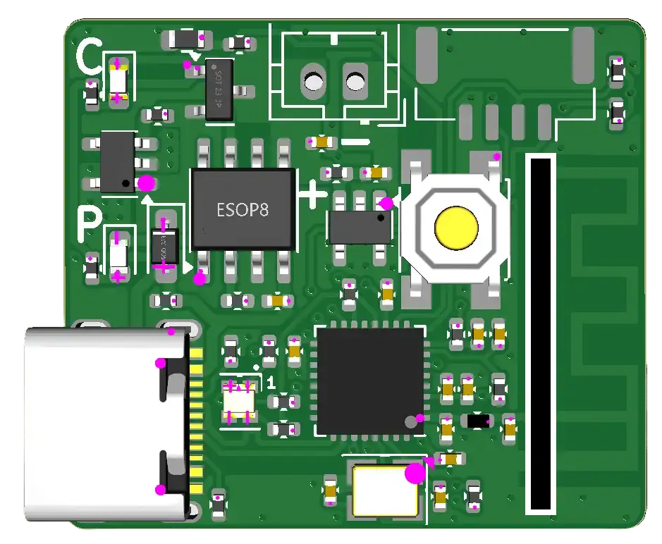</td>
    <td align="center">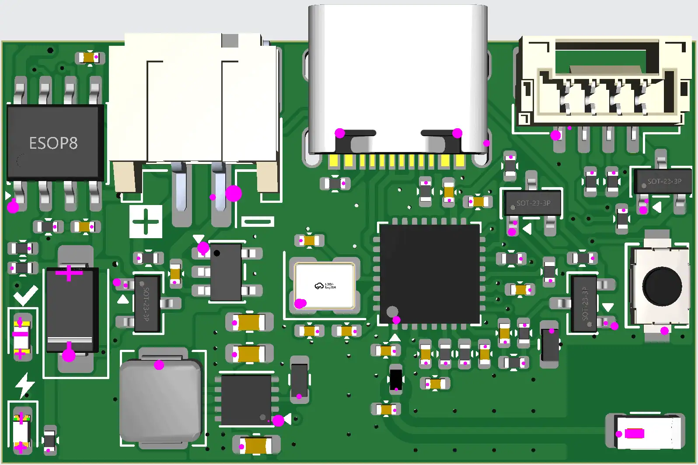</td>
  </tr>
  <tr>
    <td align="center">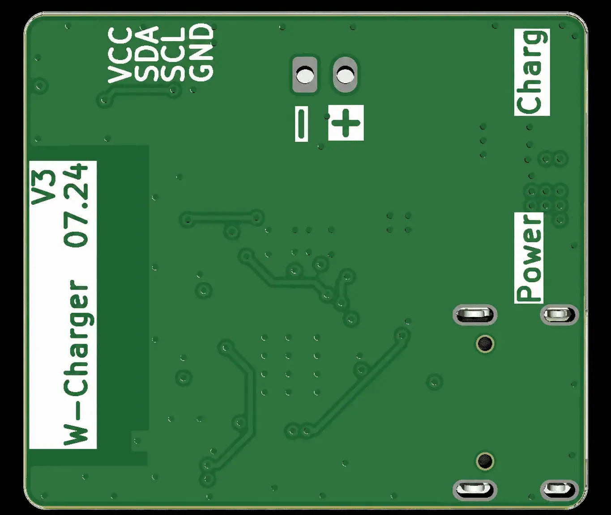</td>
    <td align="center">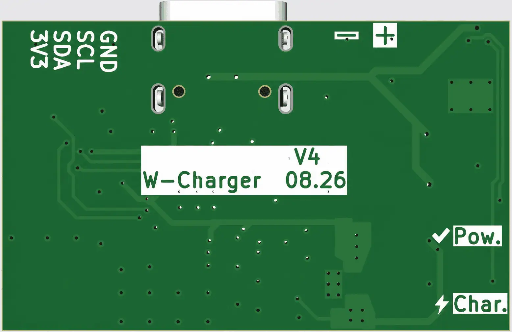</td>
  </tr>
</table>

V3 uses a 3.3 V regulator and switchable sensor rail. V4 adds a buck-boost
supply, switched I²C pull-ups and battery measurement, a side-entry connector
and revised charging indicators. Below 2.8 V or with an invalid battery reading,
V4 disables sensors and checks the battery once every 24 hours; recovery requires
2.95 V. Actual runtime depends on the cell, sensor and interval.

KiCad sources, BOMs and manufacturing outputs are in [`PCB/`](PCB/), including
the [V4 production package](PCB/Version%204/ESP32-C3-V4/production/).

</details>

> [!CAUTION]
> Recovering lithium cells requires suitable experience. Never use swollen,
> punctured, corroded, hot, leaking or deeply discharged cells. Prevent short
> circuits and verify polarity/voltage. This is an experimental prototype;
> electrical, thermal, RF, accuracy and runtime acceptance require bench testing.

## From clone to first measurement

Install Git, Python and PlatformIO, then clone the repository. Before the first
build, install Python's `cryptography` package and initialize **your own**
installation signing identity as described in the [OTA guide](Firmware/OTA.md#initial-installation).
Keep the same key for the station and both sensor targets. Preserve an existing
installation's key when updating it.

```sh
python Firmware/upload.py
# Or choose the connected board directly:
python Firmware/upload.py station
python Firmware/upload.py sensor-v4
python Firmware/upload.py sensor-v3
```

1. Flash the station and join its `W-Charger-XXXXXX` setup network.
2. Follow the browser wizard for Wi-Fi, a default interval and optional website password/cloud setup.
3. Flash the sensor target matching the physical PCB V3 or V4.
4. Open **Find sensors**, name the node, select its sensor and save.
5. Use the dashboard for measurements, settings, recordings and signed updates.

**Current release: [4.4.1 / 40401](Firmware/releases/README.md)** — compact
dashboard, adaptive history, touch inspection and long-uptime/recovery fixes.
The [complete bundle](Firmware/releases/w-charger-4.4.1.zip) includes the station
application, both sensor packages, installation instructions and checksums.
Published sensor packages require the signing identity trusted by the installed
base firmware; new builders use their own key and matching packages.

> [!IMPORTANT]
> Normal station USB updates preserve settings, pairing and archives. For an
> existing compatible layout, `python Firmware/upload.py station --application-only`
> updates only the application; the supplied station BIN is written at `0x10000`.
> Only the explicit factory-reset target erases all flash. Older layouts need the
> [one-time migration](Firmware/RECORDINGS.md#one-time-usb-migration).
> Disconnect a recovered battery before the first USB upload.

<details>
<summary><strong>Documentation, development and security</strong></summary>

Only [`Firmware/`](Firmware/README.md) is maintained. Its independent
[`station_s3`](Firmware/station/README.md),
[`sensor_pcb_v3` and `sensor_pcb_v4`](Firmware/sensor/README.md) targets share
protocol V5. [`Readme/`](Readme/) contains documentation graphics.

- [Changes and release notes](Firmware/CHANGELOG.md) · [Packages and checksums](Firmware/releases/README.md)
- [Precision sensors](Firmware/PRECISION_SENSORS.md) · [Recordings and CSV](Firmware/RECORDINGS.md)
- [Power management](Firmware/POWER_MANAGEMENT.md) · [Architecture](Firmware/ARCHITECTURE.md)
- [Regression checks](Firmware/tests/README.md) · [Hardware test plan](Firmware/HARDWARE_TESTPLAN.md)
- [Publication checks and historical findings](Firmware/PUBLICATION_REVIEW.md)

Rebuild the UI images with `node Readme/generate-ui-screenshots.cjs` using
Playwright and Sharp; `CODEX_NODE_MODULES` can point to their package directory.
The generator renders the embedded pages locally without connecting to a station.

The dashboard belongs on a trusted local network: website access supports a
password but uses HTTP. ThingSpeak uses HTTPS. ESP-NOW validates packet
version/length/CRC; it currently has no per-device cryptographic authentication.
Before publication, run `python Firmware/tools/check_publication.py` and enable
the staged/pushed-blob guards with `git config core.hooksPath .githooks`.

Project sources use the [MIT License](LICENSE). The optional BME680 build
downloads Bosch BSEC2 under its separate license; the project license does not
relicense that dependency.

</details>
